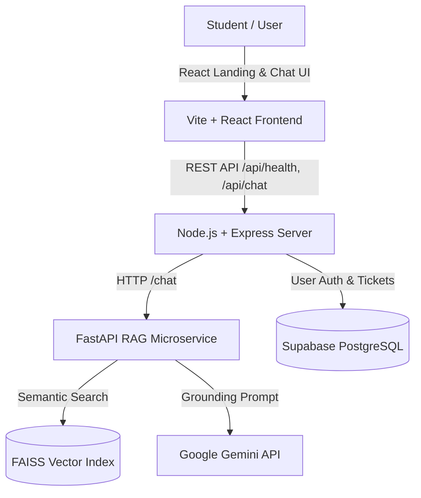

# CampusSaathi AI - Architecture Overview

## Core Components
1. **Client (`/client`)**: React + Vite UI styled in brand blue and white. Includes landing page, navigation, features section, guest & student login, and interactive chatbot with source citations.
2. **Backend (`/server`)**: Node.js + Express proxy and API server. Exposes `/api/health` and forwards chat queries to RAG service.
3. **RAG Pipeline (`/rag`)**:
   - **Google Colab (`CampusSaathi_RAG.ipynb`)**: Extract PDF text, chunk, embed, build FAISS vector index, test Gemini generation.
   - **FastAPI Service (`main.py`)**: Endpoints `/health`, `/ingest` (upload PDF), and `/chat` (semantic search + Gemini answer generation).
4. **Database (`/docs/SUPABASE_SCHEMA.sql`)**: Supabase PostgreSQL schemas for `profiles`, `conversations`, `messages`, and `support_tickets` with Row-Level Security (RLS).
